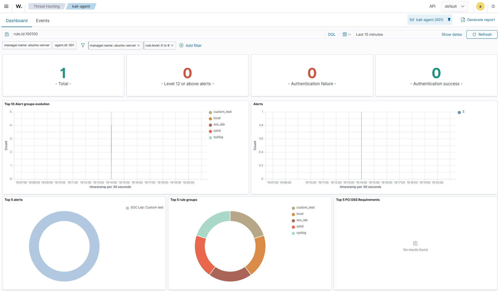

# SOC Monitor Lab - Wazuh SIEM

## Project Overview
A home lab project for monitoring security events using Wazuh SIEM. This project demonstrates agent-based security monitoring and custom alert rule creation.

## Lab Environment
- Wazuh Server: Ubuntu Server
- SIEM: Wazuh 4.14
- Agent: Kali Linux
- Agent Name: kali-agent
- Custom Rule ID: 100100

## Completed Tasks
- [x] Wazuh Indexer installed and running
- [x] Wazuh Manager installed and running
- [x] Wazuh Dashboard accessible
- [x] Kali Linux agent installed and connected
- [x] Sudo security events visible in Threat Hunting
- [x] Custom test event generated from Kali Linux
- [x] Custom Wazuh rule (100100) created and verified in manager alerts
- [x] Project repository published on GitHub

## Pending Tasks
- [x] Verify custom alert in Dashboard Events
- [x] Capture screenshots of the dashboard
- [x] Complete final project documentation

## Custom Alert Test
Test event generated on Kali Linux:

`logger "SOC_LAB_TEST_EVENT: Kali agent test successful"`

Custom rule description:

`SOC Lab: Custom test event received from agent`

The Wazuh manager confirmed this alert for agent `kali-agent`.

## Learning Outcomes
- Basic Wazuh SIEM deployment
- Linux agent integration
- Security event monitoring
- Custom Wazuh detection rule creation
- Alert verification using Wazuh logs

## Dashboard Screenshots

### Screenshot 1: Custom Alert in Threat Hunting Events

Custom Wazuh rule `100100` successfully detected the test event from the Kali Linux agent.

### Screenshot 2: Kali Agent Threat Hunting Dashboard

The dashboard displays the custom alert and agent monitoring information.

### Screenshot 3: Custom Alert Verification

The Events page confirms the custom alert with rule ID `100100` and severity level `5`.

## Project Documentation

[Download SOC Monitor Lab Report (PDF)](SOC%20MONITOR%20LAB.pdf)
